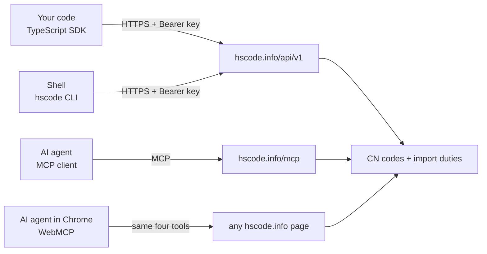
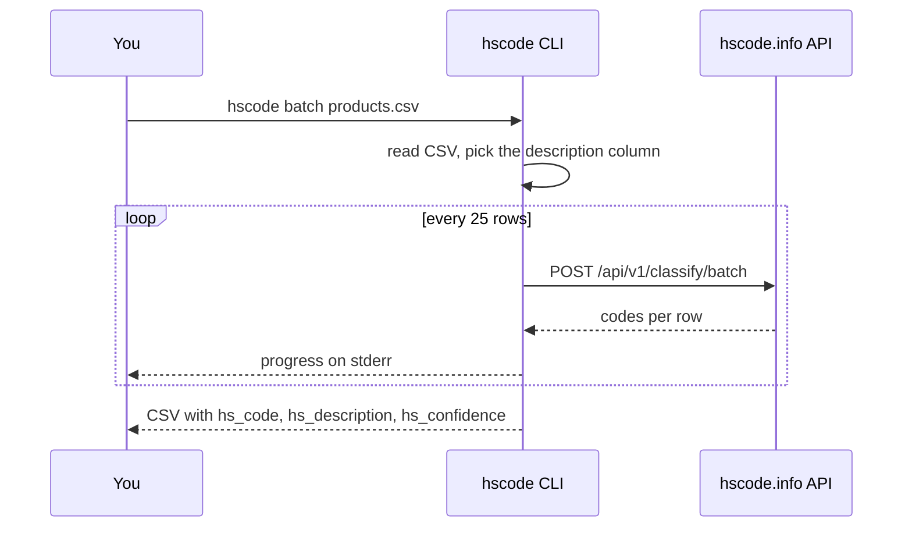

# hscode

EU customs tariff (TARIC) API, SDK and CLI: classify products into HS / CN / TARIC codes and get import duties.

[](https://www.npmjs.com/package/@hscode/sdk)
[](https://pypi.org/project/hscode/)
[](LICENSE)
[](https://github.com/hscode-info/hscode/actions/workflows/ci.yml)

This is the open source client for [hscode.info](https://hscode.info), an HS code API and lookup for the EU Combined Nomenclature. Call the TARIC API from Node.js or TypeScript, from the shell, or from an AI agent over MCP.

## Quick start

```bash
export HSCODE_KEY=...   # free key: https://hscode.info/en/account
npx @hscode/sdk classify "cotton t-shirt"
```

```ts
import { createClient } from '@hscode/sdk';

const { results } = await createClient().classify({ text: 'cotton t-shirt' });
console.log(results[0].goods_code);
```

> [!NOTE]
> Advisory only. Only a BTI from customs is legally binding.

## Why hscode.info

- HS code classification from a plain product description, in any language.
- HS code lookup and search in German, English and French: [Zolltarifnummer](https://hscode.info/de) finden, nomenclature combinée, tarif douanier.
- Import duty per origin, with preferences, quotas, anti-dumping and the legal base. Use it as a customs duty calculator input.
- Every yearly TARIC snapshot from 2016 to 2026, latest October 2026. The current snapshot has 16,742 goods codes.
- Official European Commission TARIC data.
- One REST API, one [OpenAPI spec](https://hscode.info/api/v1/openapi.json), one SDK, one CLI and an MCP server.

Browse codes by product on [hscode.info/en/hs-code](https://hscode.info/en/hs-code).

## How a request flows



## Packages

| Package | Language | Install | Status |
| --- | --- | --- | --- |
| [`@hscode/sdk`](js/) | JavaScript / TypeScript, Node.js 20+ | `npm i @hscode/sdk` | 0.1.0 |
| [`hscode`](python/) | Python | `pip install hscode` | Coming soon |

## CLI

The `hscode` command ships with the TypeScript SDK. It reads the key from `HSCODE_KEY`.

```bash
hscode classify "cotton t-shirt" --accurate     # HS code classification
hscode lookup 6109100010                        # code details and import duty
hscode search "t-shirt"                         # HS code lookup by words
hscode history 6109100010                       # third-country duty per yearly snapshot
hscode validate 6109100010 && echo valid        # exit code for scripts and supplier checks
hscode batch products.csv > classified.csv      # CSV classification
```

Batch mode suits a Shopify export or an ERP product catalogue.



## SDK

```ts
import { createClient, HscodeError } from '@hscode/sdk';

const hscode = createClient({ apiKey: process.env.HSCODE_KEY });

const { results } = await hscode.classify({ text: 'frozen shrimp, peeled', mode: 'accurate' });
const duties = await hscode.duties({ code: results[0].goods_code });

try {
  await hscode.lookup({ code: '6109 10 00 10' });
} catch (e) {
  if (e instanceof HscodeError) console.error(e.status, e.code, e.message);
}
```

The TypeScript SDK has no runtime dependencies. Types are generated from the [OpenAPI spec](openapi.json). Read the [package page](js/README.md) for every method.

## MCP and WebMCP for AI agents

Connect any MCP client to the remote MCP server at [hscode.info/mcp](https://hscode.info/mcp). One-click setup for Claude, Cursor, VS Code and Gemini CLI is on the [developers page](https://hscode.info/en/developers). The tools are `classify`, `lookup_code`, `search_codes` and `duty_history`.

In Chrome, the same four tools are available on every hscode.info page through WebMCP. An AI agent in the browser can classify goods without any setup.

Machine-readable site summary for LLMs: [llms.txt](https://hscode.info/llms.txt).

## Accuracy

On 1,000 real EU Binding Tariff Information (BTI, also called EBTI) rulings sampled from a pool of about 120,000, covering 94 chapters, the first suggestion is right:

| Digits | Level | First suggestion correct |
| --- | --- | --- |
| 2 | Chapter | 91 % |
| 4 | Heading | 87.9 % |
| 6 | Subheading | 84.7 % |

As of October 2026, Precise mode. Details: [accuracy](https://hscode.info/en/info/accuracy).

> [!IMPORTANT]
> Advisory only. Only a BTI from customs is legally binding.

## Pricing

The free plan has 30 AI units and 100 lookups a day, with no credit card. Quick AI costs 1 unit and Precise costs 5. Paid plans start at $19 a month. See [pricing](https://hscode.info/en/pricing).

## Data

Duties, nomenclature and measures come from the official European Commission TARIC database. The API serves every yearly snapshot from 2016 to 2026 in German, English and French. Queries can be in any language.

## Links

- [hscode.info](https://hscode.info): HS code lookup and classification
- [Developers](https://hscode.info/en/developers): API, SDK, CLI and MCP setup
- [API reference](https://hscode.info/api/v1/docs) and [OpenAPI spec](https://hscode.info/api/v1/openapi.json)
- [MCP server](https://hscode.info/mcp) and [llms.txt](https://hscode.info/llms.txt)
- [HS codes by product](https://hscode.info/en/hs-code)
- [Pricing](https://hscode.info/en/pricing) and [accuracy](https://hscode.info/en/info/accuracy)
- Zolltarifnummer finden: [hscode.info/de](https://hscode.info/de)

## License

[MIT](LICENSE)
