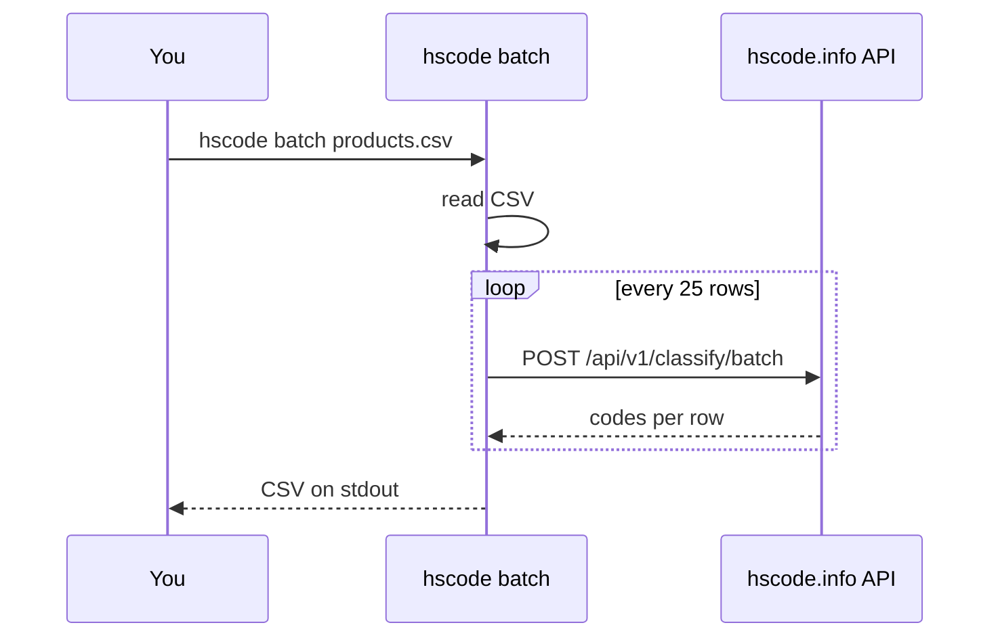

# @hscode/sdk

[](https://www.npmjs.com/package/@hscode/sdk)
[](https://github.com/hscode-info/hscode/blob/main/LICENSE)
[](https://github.com/hscode-info/hscode/actions/workflows/ci.yml)

TypeScript SDK and CLI for the [hscode.info](https://hscode.info) EU customs tariff (TARIC) API. Classify products into HS / CN codes and get import duties from Node.js, the shell or an AI agent.

- HS code API, HS code lookup and HS code classification for the EU Combined Nomenclature.
- German, English and French descriptions. Queries in any language: Zolltarifnummer, nomenclature combinée, tarif douanier.
- Zero runtime dependencies. ESM only. Node.js 20 or newer.
- Types are generated from the [OpenAPI spec](https://hscode.info/api/v1/openapi.json).

> [!NOTE]
> Advisory only. Only a BTI from customs is legally binding.

## Install

```bash
npm i @hscode/sdk
```

Get a key on your [hscode.info account](https://hscode.info/en/account). The free plan has 30 AI units and 100 lookups a day, with no credit card. Paid plans start at $19 a month. See [pricing](https://hscode.info/en/pricing).

## Quick start

SDK:

```ts
import { createClient } from '@hscode/sdk';

const hscode = createClient({ apiKey: process.env.HSCODE_KEY });
const { results } = await hscode.classify({ text: 'cotton t-shirt', mode: 'accurate' });
console.log(results[0].goods_code, results[0].description);
```

CLI:

```bash
export HSCODE_KEY=...
npx @hscode/sdk classify "cotton t-shirt"
```

## SDK reference

`createClient({ apiKey?, baseUrl?, fetch? })` returns a client.

| Option | Default |
| --- | --- |
| `apiKey` | `process.env.HSCODE_KEY` |
| `baseUrl` | `https://hscode.info` |
| `fetch` | global `fetch` |

`lang` is `'de' | 'en' | 'fr'` and defaults to `'en'`. `mode` is `'fast'` (Quick, 1 AI unit) or `'accurate'` (Precise, 5 units, adds `confidence` and `reasoning`). When you omit `year`, the client looks up the latest snapshot once and reuses it. Every method accepts an optional `signal` (`AbortSignal`). Methods return the API response as typed by the OpenAPI schema.

Goods codes may contain spaces or dots. The client strips them and checks for 10 digits before it sends a request.

### classify

```ts
const { results, question, disclaimer } = await hscode.classify({
  text: 'frozen shrimp, peeled',
  mode: 'accurate',
  lang: 'de'
});
```

`POST /api/v1/classify`. Each result has `goods_code`, `description`, `path`, `score`, `confidence`, `reasoning` and `duties`.

### classifyBatch

```ts
const { items } = await hscode.classifyBatch({
  items: [{ id: 'SKU-1', text: 'cotton t-shirt' }, { id: 'SKU-2', text: 'steel nails' }]
});
```

`POST /api/v1/classify/batch`. Up to 25 items per call. An item that fails has `error` set.

### lookup

```ts
const code = await hscode.lookup({ code: '6109 10 00 10', year: '2025', lang: 'fr' });
```

`GET /api/v1/{lang}/{year}/codes/{code}`. Returns the description, hierarchy, duties and signals such as quotas and restrictions. Pass `history: true` to add the duties of every yearly snapshot.

### history

```ts
const { history } = await hscode.history({ code: '6109100010' });
```

Same as `lookup` with `history: true`. Use it for duty history by year.

### search

```ts
const { items } = await hscode.search({ query: 't-shirt' });
```

`GET /api/v1/{lang}/{year}/search`. Matches codes by words.

### duties

```ts
const { items } = await hscode.duties({ code: '6109100010' });
```

`GET /api/v1/{year}/duties/{code}`. Import duties per origin, with legal base and measure type. Use it as the input of a customs duty calculator.

### chapters and chapter

```ts
const { items } = await hscode.chapters();
const chapter61 = await hscode.chapter({ chapter: '61' });
```

The nomenclature chapters, and the rows of one 2-digit chapter.

### snapshots

```ts
const { latest, snapshots, langs } = await hscode.snapshots();
```

The yearly TARIC snapshots from 2016 to 2026.

## CLI reference

The package installs a `hscode` command. It reads the key from `HSCODE_KEY` or `--key`. Output is plain aligned text. Add `--json` for raw JSON.

| Command | What it does |
| --- | --- |
| `hscode classify <text...> [--accurate] [--lang de]` | Top codes with description, confidence when present, and the third-country duty. Ends with the disclaimer. |
| `hscode lookup <code> [--year] [--lang]` | Description, hierarchy and duties of a code. |
| `hscode search <query...> [--year] [--lang]` | Search codes by words. |
| `hscode history <code> [--lang]` | Third-country duty in every yearly snapshot. |
| `hscode validate <code>` | Exit 0 and print the description if the code exists in the latest snapshot. Exit 1 if not. Exit 2 on other errors. |
| `hscode batch <file.csv> [--column description] [--accurate] [--lang]` | CSV classification. Writes the CSV to stdout with `hs_code`, `description` and `confidence` added. |

Run `hscode --help` or `hscode <command> --help` for usage, and `hscode --version` for the version.

```bash
hscode classify "cotton t-shirt" --accurate --lang de
hscode lookup 6109100010
hscode search "t-shirt"
hscode history 6109100010
hscode validate 6109100010 && echo "valid code"
hscode batch products.csv --column description > classified.csv
```

`batch` takes the first row as the header and the first column unless you pass `--column`. It sends 25 rows per request and prints progress to stderr. It suits a Shopify product export or an ERP catalogue.



## Errors

Every failure throws `HscodeError`.

```ts
import { HscodeError } from '@hscode/sdk';

try {
  await hscode.lookup({ code: '1234' });
} catch (e) {
  if (e instanceof HscodeError) console.error(e.status, e.code, e.message);
}
```

| Field | Meaning |
| --- | --- |
| `status` | HTTP status (400, 401, 404, 429, 503). `0` for errors raised before a request. |
| `code` | The API `error` string, or `invalid_request` and `missing_api_key` for local errors. |
| `message` | A readable message. |

On HTTP 429 your plan quota is used up. The CLI then prints the message and the [pricing](https://hscode.info/en/pricing) link.

## Accuracy

On 1,000 real EU Binding Tariff Information (BTI, also called EBTI) rulings sampled from a pool of about 120,000, covering 94 chapters, the first suggestion is right at 2 digits (chapter) in 91 %, at 4 digits (heading) in 87.9 % and at 6 digits (subheading) in 84.7 %. As of October 2026, Precise mode. Details: [accuracy](https://hscode.info/en/info/accuracy).

Advisory only. Only a BTI from customs is legally binding.

## For AI agents

The same four tools are available as an MCP server at [hscode.info/mcp](https://hscode.info/mcp): `classify`, `lookup_code`, `search_codes` and `duty_history`. Setup for Claude, Cursor, VS Code and Gemini CLI is on the [developers page](https://hscode.info/en/developers). See also [llms.txt](https://hscode.info/llms.txt).

## Links

- [hscode.info](https://hscode.info): HS code lookup and classification
- [Developers](https://hscode.info/en/developers)
- [API reference](https://hscode.info/api/v1/docs)
- [Pricing](https://hscode.info/en/pricing)
- [HS codes by product](https://hscode.info/en/hs-code)
- Zolltarifnummer finden: [hscode.info/de](https://hscode.info/de)
- [Source on GitHub](https://github.com/hscode-info/hscode)

MIT license.
